# BTC Forecast MLOps: Member 2 Report Sections

Sections B2, C, D5–D6 and E: data pipeline, orchestration, scaling and verification.

---

## B2. Local stack with docker-compose

`docker-compose.yml` starts three services on one Docker network:

| Service | Image | Purpose |
|---|---|---|
| `postgres` | `postgres:16` | Airflow metadata database (DAG runs, task states, users). Healthcheck with `pg_isready`. |
| `airflow` | `apache/airflow:2.10.5-python3.10` | Scheduler and web UI (`standalone`, port 8080), `LocalExecutor` on Postgres. |
| `api` | built from `app/Dockerfile` | The Flask/Gunicorn API on port 5000. |

Design choices:

- **Postgres instead of SQLite.** SQLite only supports the SequentialExecutor, which runs one task at a time. Postgres allows the LocalExecutor.
- **Startup order.** `depends_on: condition: service_healthy` means Airflow starts only after the database is ready.
- **Shared model folder.** Airflow and the API both mount the host folder `./models`. Airflow writes `model.pkl`, and the API reads the same file.
- **Service names.** Containers reach each other by name: the DAG calls `http://api:5000/reload`.
- **Shared code.** `./src` is mounted into Airflow and `PYTHONPATH=/opt/airflow` is set, so the DAG imports the same `src` functions the Docker image uses.

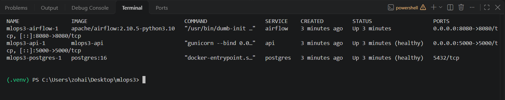
*Figure B2: all three containers up; postgres and api report `healthy`.*

---

## C. Data pipeline and orchestration

### Data and features

`src/etl_fetch.py` downloads daily BTC-USD candles from Yahoo Finance (`yfinance`), starting on 2018-01-01. If yfinance fails or returns nothing, it falls back to the public Binance klines API. The cleaning step:

- keeps `Date, Open, High, Low, Close, Volume`
- removes the timezone and formats dates as `YYYY-MM-DD`
- drops today's unfinished candle (crypto trades 24/7, so today's price is still changing)
- removes duplicates and sorts by date

A typical run gives about 3,250 rows (2018-01-01 to yesterday).

`src/preprocess.py` adds four features: `return_1d` (daily % change), `ma_7` and `ma_30` (moving averages), and `volatility_7` (7-day standard deviation of returns). It then drops the first rows, which don't yet have a full 30-day window, leaving about 3,220 rows. Both scripts work as a Python function and as a command-line tool, so Airflow, Kubeflow and the Kubernetes Job all run the same code.

### C1. Airflow DAG `btc_etl_pipeline`

Settings:

- **Schedule:** `@daily`, with `catchup=False`
- **Retries:** 1, after 2 minutes
- **Owner:** `btc-team`

The DAG chains four `PythonOperator` tasks:

```
fetch_data  ->  preprocess  ->  train_evaluate  ->  reload_api
```

1. `fetch_data` writes `data/raw/btc_raw.csv`.
2. `preprocess` writes `data/processed/btc_features.csv`.
3. `train_evaluate` fits ARIMA(5,1,0) on the last 730 days, holding out the last 7 days. It saves the model only if MAPE ≤ 10%, and the metrics dictionary is stored as an XCom.
4. `reload_api` calls `POST /reload` with the API key. `raise_for_status()` turns the task red if the API rejects the call.

Paths, the API URL and the key come from environment variables. The heavy imports (statsmodels) happen inside the task functions, so the scheduler can re-parse the DAG file quickly.

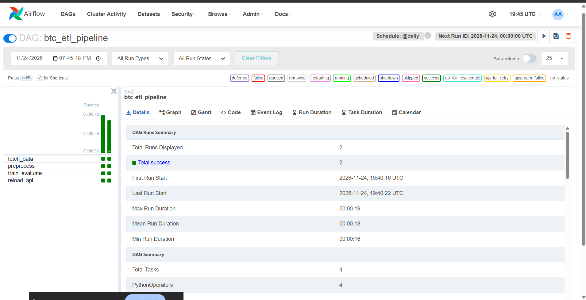
*Figure C1a: two runs of `btc_etl_pipeline` (scheduled and manual) with all four tasks successful.*

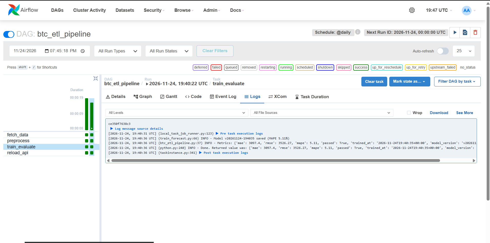
*Figure C1b: `train_evaluate` log showing the new model version and its metrics.*

**Result:** the model passed the quality gate with MAE 3,097, RMSE 3,526 and MAPE 5.11%. Afterwards, `GET /metrics` on the API showed the new `trained_at`, which confirms the hand-off from training to serving.

### C2. Kubeflow pipeline

`kubeflow/btc_kfp_pipeline.py` (KFP SDK v2, `kfp==2.7.0`) defines three container components that all run the published image `ammarhassan1/btc-forecast-api:latest`:

| Component | Command | Input | Output |
|---|---|---|---|
| `fetch_data` | `python -m src.etl_fetch` | none | `Dataset` raw_data |
| `preprocess` | `python -m src.preprocess` | `Dataset` raw_data | `Dataset` features |
| `train` | `python -m src.train_forecast` | `Dataset` features | `Model` |

How the pipeline fits together:

- **Order:** steps are connected by passing typed artifacts, which also sets the execution order.
- **Caching:** caching is **disabled for the fetch step**. Because fetch has no inputs, KFP would otherwise treat every run as identical and reuse the first download.
- **Compiled spec:** the pipeline compiles to `kubeflow/btc_kfp_pipeline.yaml` (120 lines). This spec can be uploaded to the Kubeflow Pipelines UI for a run or a recurring run.

We didn't install a full Kubeflow deployment on the laptop, because it needs more memory than is left next to Minikube. The same image and the same three commands were run on the cluster by the `btc-train` Job, which trained a model with MAPE 5.11%.

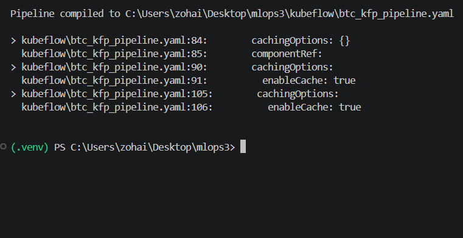
*Figure C2: pipeline compiled; the fetch step has caching disabled (`cachingOptions: {}`) while the other steps keep `enableCache: true`.*

---

## D5. Horizontal Pod Autoscaler and load test

`k8s/hpa.yaml` (`autoscaling/v2`) scales the Deployment `btc-api` between **2 and 8 pods** to keep average CPU at **60% of the request**. With a 100m request per pod, that target is 60m. metrics-server supplies the CPU numbers.

`loadtest/locustfile.py` simulates users who mostly send `POST /predict` with a random 200-price history (weight 3) and sometimes `GET /health` (weight 1). A history forces the API to refit ARIMA, which creates real CPU load; `/health` alone would never trigger scaling.

**Scaling.** Under load, CPU went from 1% to 481% of the target. The HPA added pods step by step, from 2 to 4, 6, 7 and finally the maximum of 8, within about 3 minutes. When the load stopped, the HPA waited its 5-minute stabilization window before scaling back down to 2.

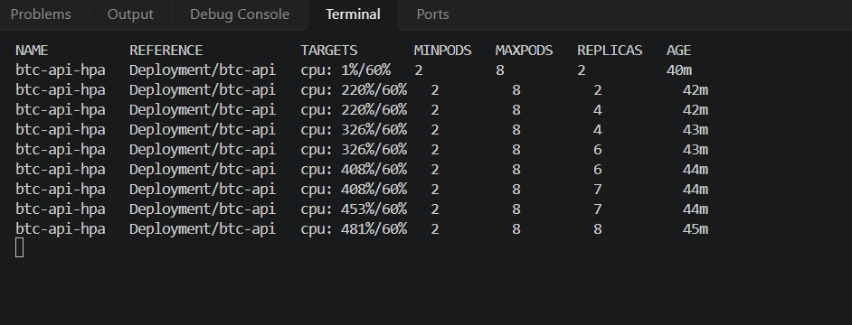
*Figure D5a: `kubectl get hpa --watch`: CPU 1% → 481%, replicas 2 → 4 → 6 → 7 → 8.*

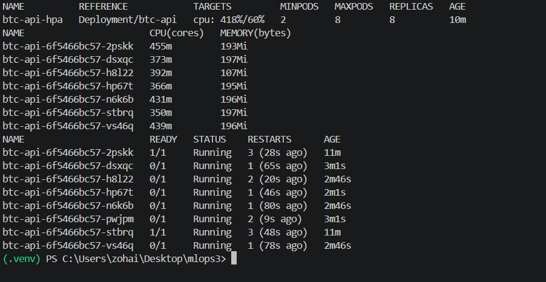
*Figure D5b: 8 replicas, each pod close to its 500m CPU limit.*

**Load test results:**

| Run | Users | Duration | Requests | Failures | `/predict` median | `/predict` p95 |
|---|---|---|---|---|---|---|
| Load test | 5 | 3 min | 327 | 3 (0.9%) | 1.0 s | 5.5 s |
| Heavy load | 20 | 5 min | 532 | 281 (53%) | n/a | n/a |
| Stress test | 100 | ≤ 5 min | 2,329 | 2,042 (88%) | n/a | n/a |

At 5 users the system served the load reliably. `/health` averaged 20 ms. The three failures were `503` responses during the short moment a new pod was joining.

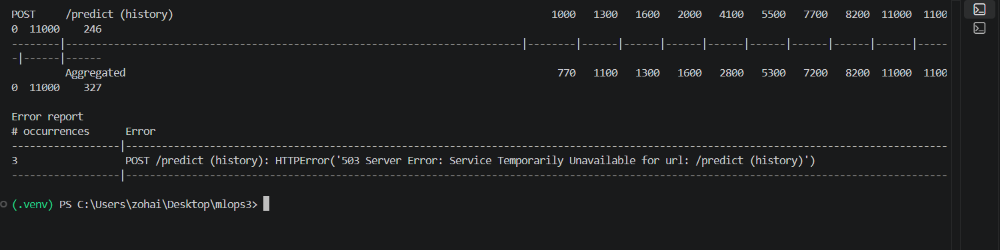
*Figure D5c: final Locust report of the 5-user run.*

**Analysis of the heavy runs.** The HPA worked correctly in every run and reached `maxReplicas`. After that, the limit was the hardware:

1. **The node was full.** Minikube runs on one node with 4 CPUs, and 8 pods × 500m limit = 4 CPUs, so every pod was being throttled.
2. **Health checks got stuck.** One ARIMA refit then takes several seconds. Each pod has only 2 synchronous Gunicorn workers, so `/health` waited behind the refits.
3. **Kubernetes reacted as designed.** The readiness probe failed and the pod was taken out of the Service, which nginx reported as `503`. Repeated liveness failures restarted the container, which showed up as `502`.

Kubernetes protected the system as intended, but the cluster had no more capacity to add. In a real deployment, the next steps would be:

- add nodes with a Cluster Autoscaler
- use threaded Gunicorn workers (`--worker-class gthread`) so health checks are not blocked by slow predictions

---

## D6. Ingress

`k8s/ingress.yaml` routes host `btc-forecast.local`, path `/` (Prefix), to `btc-api-service:80`, using the NGINX ingress controller (`ingressClassName: nginx`). It also sets `proxy-read-timeout: "120"`, the same as Gunicorn's timeout, so slow refits under load aren't cut off at nginx's default 60 s.

On Windows with the Docker driver, `minikube tunnel` forwards port 80 to the controller, and the hosts file maps `btc-forecast.local` to `127.0.0.1`.

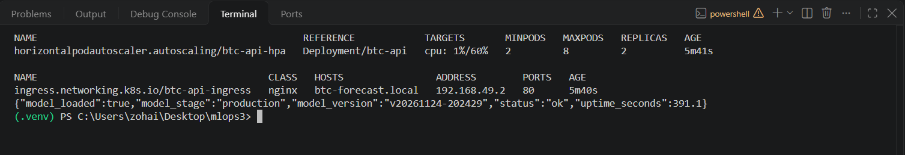
*Figure D6: HPA target `cpu: 1%/60%` (2 pods while idle), the Ingress for `btc-forecast.local`, and `/health` answered through the Ingress.*

---

## E1. Self-healing (chaos test)

While watching the pods with `kubectl get pods -l app=btc-api -w`, we deleted one pod on purpose. The ReplicaSet immediately created a replacement:

1. The old pod went `Terminating` → `Completed`.
2. The new pod went `Pending` → `ContainerCreating` → `Running 1/1` in about **11 seconds**.

The other 7 pods stayed `Running 1/1`, so the Service kept routing requests to them while the replacement started. The new pod loaded the same model because the model lives on the PersistentVolume, not inside the pod.

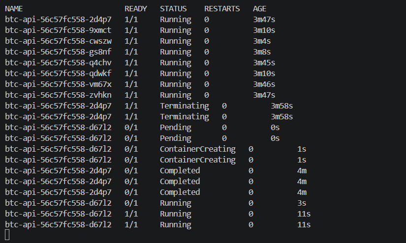
*Figure E1: deleted pod replaced automatically; desired replica count restored.*

---

## E2. End-to-end verification

| Step | Result |
|---|---|
| 1. Airflow runs `btc_etl_pipeline` | All 4 tasks successful; new model saved (MAPE 5.11%); API `/metrics` shows the new `trained_at` |
| 2. Code merged to `main` through a pull request | GitHub Actions: lint and tests pass, image pushed to Docker Hub with tags `latest` and the commit SHA |
| 3. `kubectl rollout restart deployment btc-api` | Rolling update of all 8 pods to the newest image, finished with `successfully rolled out` |
| 4. `POST /predict` through `btc-forecast.local` | 7 dated predictions returned by the cluster |

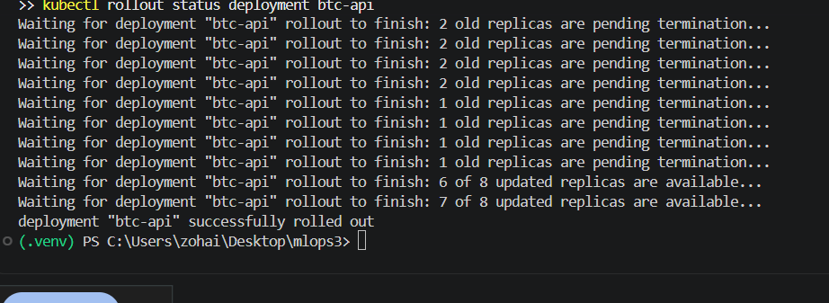
*Figure E2a: rolling restart pulls the latest image without downtime.*

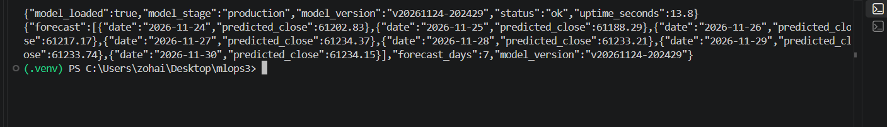
*Figure E2b: `/health` and a 7-day forecast served through the Ingress after the rollout.*

---

## E. Performance summary

| Area | Result |
|---|---|
| Model quality (last 7 days held out) | MAE 3,097 USD, RMSE 3,526 USD, MAPE 5.11% (gate: MAPE ≤ 10%) |
| Training time | Full pipeline (fetch, features, train) ≈ 20 s in Airflow, < 1 min as a Kubernetes Job |
| Latency, 5 users | `/health` avg 20 ms; `/predict` with history refit median 1.0 s, p95 5.5 s |
| Throughput, 5 users | 1.8 requests/s, 0.9% errors |
| Scaling | HPA 2 → 8 pods in about 3 minutes at 481% of the CPU target; scale-down after 5 minutes idle |
| Recovery | Deleted pod replaced and ready in about 11 s while the other pods kept serving |

**Limitations:**

- **Hardware.** Throughput is limited by one 4-CPU laptop node. ARIMA refits are CPU-heavy, so `/predict` with a custom history is the expensive call. The default `/predict` (saved model) is fast.
- **Kubeflow.** The pipeline was compiled and its steps verified on Kubernetes, but it wasn't run inside a full Kubeflow deployment.
